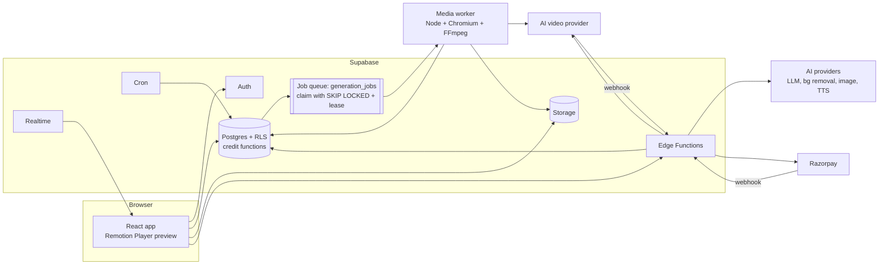

# AdMitra AI — React + Supabase Architecture & Design Plan

Nov 24, 2026 · @Mayur Pawar · Companion to [prd.md](prd.md) (Complete Product Requirements v2)

## 1. Summary

AdMitra uses React for the website and Supabase for the backend and database (Auth, Postgres, Storage, Edge Functions, Queues, Realtime, Cron), plus a separate **media worker** for video rendering, outline tracing and AI video post-processing. This replaces the Java Spring Boot + MySQL stack in the original v2 requirements.

Changes to the original reference diagram:

1. **Add a media worker outside Supabase.** Supabase Edge Functions have [256 MB memory and 2 seconds of CPU time per request](https://supabase.com/docs/guides/functions/limits), so they cannot render Outline Highlight or mascot videos with headless Chrome and FFmpeg, trace outlines, or process AI video clips. A Node service in a container takes jobs from a Supabase Queue.
2. **Separate AI from payments.** AI calls go through their own Edge Functions; Razorpay talks to its own Edge Functions (create subscription, webhook).
3. **The browser never holds AI, Razorpay or SMS secrets.** All keys live in Edge Function or worker secrets; the React app talks only to Supabase.
4. **AI video is asynchronous.** Clips take minutes, longer than an Edge Function's wall-clock limit, so generation is started by an Edge Function, finished by a provider webhook (or worker polling), and post-processed by the media worker.

## 2. Architecture at a glance



The React app talks only to Supabase. Edge Functions hold every secret and call AI providers, the AI video provider and Razorpay. Media jobs (render, trace, AI clip processing) are enqueued inside Postgres functions and picked up by the media worker, which saves results to Storage and updates job rows; the app sees progress through Realtime.

## 3. Frontend (React)

A single-page React app built with Vite, talking only to Supabase through `supabase-js` and Edge Functions.

| Concern      | Choice                                    | Why                                       |
| ------------ | ----------------------------------------- | ----------------------------------------- |
| Build tool   | Vite + React + TypeScript                 | Fast builds, typed code                   |
| Styling      | Tailwind CSS + shadcn/ui components       | Consistent, accessible UI quickly         |
| Routing      | React Router                              | Public pages, app pages, admin            |
| Server data  | TanStack Query + supabase-js              | Caching, loading states, retries          |
| Local state  | Zustand                                   | Studio and editor state                   |
| Forms        | react-hook-form + zod                     | Brief and profile forms with validation   |
| Live preview | Remotion Player                           | Same style templates as the media worker  |
| Realtime     | Supabase Realtime                         | Job progress without refreshing           |
| i18n         | i18next                                   | English, Hindi, Marathi interface         |
| Errors       | Sentry                                    | Frontend errors with release tags         |
| Hosting      | Vercel or Netlify                         | Static hosting + CDN                      |

### Folder structure (monorepo)

```
admitra/
  apps/
    web/                    React app
      src/
        app/                router, providers, layouts
        pages/              public/, auth/, app/, admin/
        features/
          auth/
          business/         profile, onboarding, import
          brand-kit/
          products/         library, background removal, fact confirmation
          campaigns/        brief, library
          studio/           poster, style picker, AI scene picker, style remix
          editor/
          export/           formats, QR, share
          billing/          plans, credits, Razorpay checkout
          admin/
        components/ui/      shadcn components
        lib/                supabaseClient.ts, queryClient.ts, utils
        hooks/
        i18n/
    media-worker/           Node service (see section 5.2)
  packages/
    styles-engine/          shared signature-style templates (browser + worker)
      outline-highlight/
      mascot/
      ai-scene/             AI clip layer + composite mode
      shared/               end card, text, fonts, music sync
    shared-types/           generated Supabase types, job param schemas (zod)
  supabase/
    migrations/             SQL tables, RLS, functions
    functions/              Edge Functions (Deno)
    seed.sql
```

`styles-engine` is one versioned package used by both the browser preview and the media worker, so preview and export match. Each job records the `styles-engine` version it rendered with. Job parameter schemas live in `shared-types` and are validated with zod on both sides.

### Fonts (preview = export)

All template fonts (Latin plus Noto Sans Devanagari and other Indian-script fonts) ship as files inside `styles-engine/shared/fonts`. The browser loads them through `@font-face`, and the worker image installs the same files. No template relies on system fonts.

### Routes

- Public: `/`, `/styles`, `/pricing`, `/try`, `/login`, `/signup`, `/forgot-password`, `/reset-password`, `/contact`
- Legal (linked from the footer; required by Razorpay): `/privacy`, `/terms`, `/refunds`
- Payment result: `/payment/success`, `/payment/failed` (they show "processing" until the webhook has granted access; they never grant access themselves)
- App: `/app` (dashboard), `/app/onboarding`, `/app/business`, `/app/brand`, `/app/products`, `/app/campaigns/new`, `/app/campaigns/:id/studio`, `/app/campaigns/:id/edit`, `/app/campaigns/:id/export`, `/app/library`, `/app/calendar`, `/app/billing`
- Admin: `/admin/*` (platform admins only, checked in the database)
- Public share (Growth): `/c/:slug` mini landing page, served with per-campaign Open Graph tags (see 4.5)
- QR codes point straight to the `qr-redirect` Edge Function on a short domain, not to a React route.

## 4. Supabase backend

Supabase provides login, the Postgres database, file storage, server code (Edge Functions), job queues, realtime updates and scheduled jobs. Use the Mumbai region.

### 4.1 Auth

- Email + password, Google sign-in, phone OTP. The SMS provider (MSG91 or Twilio) needs **TRAI DLT** sender ID and template registration before phone OTP can go live in India; until then, launch with email and Google.
- On sign-up, a database trigger creates the user's `profiles` row, a personal workspace, an `owner` membership and a `credit_balances` row.
- **Free try (`/try`):** uses Supabase **anonymous sign-in** with captcha (Cloudflare Turnstile or hCaptcha, supported by Supabase Auth). The anonymous user gets a temporary workspace flagged `is_trial`. Limits: 1 export per device/IP per day, using cached AI scenes only, at low resolution with a watermark. When the user signs up, the anonymous account is converted and its trial work is kept.
- Platform admins live in a separate `platform_admins` table, checked by a SQL function `is_platform_admin()`. They are never stored in workspace roles and never decided in the browser.

### 4.2 Database tables (Postgres)

**Rule:** every tenant table carries `workspace_id` (not null, indexed), so one RLS rule protects all of them.

| Table                | Key columns                                                                                                                 |
| -------------------- | --------------------------------------------------------------------------------------------------------------------------- |
| profiles             | id (= auth user), full_name, phone, language                                                                                |
| workspaces           | id, owner_id, name, type (business, agency, franchise), is_trial                                                            |
| workspace_members    | workspace_id, user_id, role (owner, member)                                                                                 |
| platform_admins      | user_id                                                                                                                     |
| business_profiles    | workspace_id, name, industry, description, phone, website, languages, phone_confirmed_at                                    |
| business_locations   | workspace_id, business_id, address, city, map_url, confirmed_at                                                             |
| brand_kits           | workspace_id, business_id, logo paths, colours, fonts, tone                                                                 |
| mascots              | workspace_id, base_character, outfit, colours                                                                               |
| products             | workspace_id, business_id, name, description, price, currency, price_confirmed_at, image path, cutout path, outline_svg, outline_status |
| campaigns            | workspace_id, business_id, goal, offer, audience, start_date, end_date, cta, language, status, facts_confirmed_at, facts_confirmed_by |
| campaign_products    | workspace_id, campaign_id, product_id, position                                                                            |
| style_templates      | id, name, type (poster, outline_highlight, mascot, ai_scene), version, params_schema, credit_cost, active                               |
| ai_scene_types       | id, industry, name, prompt_template, prompt_version, default_mode, credit_cost, active                                     |
| ai_video_clips       | workspace_id, product_id, scene_type_id, provider, model, prompt_version, aspect_ratio, mode (composite, animated_product), provider_job_id, status, file path, poster path, duration, approved_at, cost, cache_key (unique) |
| generation_jobs      | workspace_id, campaign_id, type (render, trace, ai_clip, copy, cutout), template_id, template_version, params (fact snapshot), status, progress, attempts, error, cost, provider, model |
| creative_assets      | workspace_id, campaign_id, job_id, format, file path, width, height, duration                                              |
| qr_links             | workspace_id, campaign_id, code (unique), target_url                                                                       |
| qr_scans             | workspace_id, qr_link_id, scanned_at, city (approximate)                                                                   |
| plans                | id, name, price_inr, monthly_credits, razorpay_plan_id, features                                                           |
| subscriptions        | workspace_id, plan_id, razorpay_subscription_id, status, period_end                                                        |
| payments             | workspace_id, razorpay_payment_id, amount, status, raw event                                                               |
| webhook_events       | source (razorpay, ai_video), event_id (unique), received_at, processed_at                                                  |
| credit_balances      | workspace_id (pk), available, reserved                                                                                     |
| credit_ledger        | workspace_id, kind (grant, reserve, consume, release, refund, adjust), amount, job_id or payment_id, created_at            |
| rate_limits          | workspace_id or ip_hash, action, window_start, count                                                                       |
| audit_events         | workspace_id, actor_id, action, entity, created_at                                                                         |

Agency client access (Scale phase) is a separate `client_access` table linking an agency workspace to client workspaces. It is not a workspace role.

### 4.3 Credits (atomic, no overspend)

Credits change only inside `SECURITY DEFINER` Postgres functions. The browser cannot call them for anything other than its own workspace, and cannot write ledger rows.

| Function                                          | Does                                                                                                   |
| ------------------------------------------------- | ------------------------------------------------------------------------------------------------------ |
| `create_render_job(campaign, formats)` (built M5; was `reserve_and_enqueue`) | In **one transaction**: member check, rate limit, fact check (refuses any unconfirmed fact), fact snapshot, lock `credit_balances` (`FOR UPDATE`), check `available`, move credits to `reserved`, insert the QUEUED `generation_jobs` row (the row *is* the queue entry), write ledger `reserve`. Errors carry stable codes: `facts_not_confirmed`, `insufficient_credits`, `export_in_progress`, `rate_limited`, `invalid_formats` |
| `complete_render_job(job, worker, version)` (M5)  | Worker only. COMPLETED, and moves reserved → spent exactly once; ledger `consume`                      |
| `fail_render_job(job, worker, error, retry)` (M5) | Worker only. Back to QUEUED while attempts remain; otherwise FAILED and `private.release_job_credits` returns reserved → available once; ledger `release` |
| `grant_credits(workspace_id, amount, payment_id)` | Adds credits; ledger `grant`; called by the Razorpay webhook (paid plans) or Cron (free plan)           |

`credit_balances` is the fast, locked balance; `credit_ledger` is the full history and must always add up to it (nightly check by Cron).

**Monthly credits:** paid plans get credits **only** from the Razorpay `subscription.charged` webhook. Cron grants credits **only** to free-plan workspaces. Nothing grants the same month twice.

### 4.4 Row-level security (RLS)

- RLS is on for every table.
- Tenant tables: a user can read and write rows only where `is_member(workspace_id)` is true.
- `plans`, active `style_templates` and active `ai_scene_types` are readable by everyone; writable only when `is_platform_admin()`.
- `payments`, `subscriptions`, `credit_balances`, `credit_ledger`, `webhook_events`, `rate_limits` and `generation_jobs.status` are written only by Edge Functions and the media worker using the service role, or by the credit functions. Users can only read their own.
- Fact confirmation columns (`*_confirmed_at`) are set only through an RPC that records `auth.uid()` and the time.
- A test suite signs in as a second account and must see and change nothing of the first.

### 4.5 Storage buckets

| Bucket         | Access                                    | Contents                                   |
| -------------- | ----------------------------------------- | ------------------------------------------ |
| brand-assets   | Private, workspace members                | Logos, fonts                               |
| product-images | Private, workspace members                | Original photos, cutouts, outlines         |
| ai-clips       | Private, workspace members                | Normalised AI video clips, poster frames   |
| renders        | Private; download through signed URLs     | Exported MP4, GIF, PNG, PDF                |
| showcase       | Public                                    | Opt-in gallery ads, thumbnails             |
| system-public  | Public read                               | Mascot files, template images, demo media  |
| system-private | Private; signed URLs for preview + worker | Licensed music (not publicly downloadable) |

File paths start with the workspace id (`{workspace_id}/...`) so storage policies can check membership.

Mini landing pages `/c/:slug` (Growth) are served by an Edge Function or Vercel edge function that injects per-campaign Open Graph tags, so WhatsApp and social apps show the right preview image.

### 4.6 Edge Functions

Every function checks auth, workspace membership and `rate_limits` before doing work.

| Function                     | Does                                                                                         | Release |
| ---------------------------- | -------------------------------------------------------------------------------------------- | ------- |
| generate-copy                | Calls the LLM for headlines, captions, scripts; returns drafts (never rewrites facts)        | MVP     |
| process-product-image        | Rate-limited (30/hour per workspace). Calls background removal through the `BG_REMOVAL_PROVIDER` adapter (`mock` until a provider is chosen), saves the cutout; outlines are traced in the browser and, for exports, inside the worker's Chromium (same `traceImageUrl`), so no separate `trace` job is needed yet | MVP (built M3) |
| confirm-facts                | Built as Postgres functions instead of an Edge Function: `confirm_product_price`, `confirm_business_phone`, `confirm_location` (SECURITY DEFINER, member check, records who and when, audit event). Offer and date confirmation come with campaigns in M4 | MVP (built M3) |
| create-render-job            | Built as the Postgres function `create_render_job` instead (see 4.3): one transaction, no extra hop. AI-clip approval checks join it in M6 | MVP (built M5) |
| start-ai-video               | Reads the product as the user (RLS), then `reserve_ai_clip` (cache by `md5(source image, scene, prompt version, provider, model, ratio, mode)`, rate limit 20/h, credit reserve, free first regeneration after a rejection) and submits to the `AI_VIDEO_PROVIDER` adapter (`mock` in test mode). A provider error fails the clip and returns the credits | MVP (built M6) |
| ai-video-webhook             | `verify_jwt = false`. HMAC-SHA256 over the raw body (`AI_VIDEO_WEBHOOK_SECRET`, constant-time compare) before anything is read; de-duplicates by event id in `webhook_events`; finds the clip only by the provider's job id; `ai_clip_ready` (credits spent) or `fail_ai_clip` (credits returned). Downloading real clips (`ai_clip` worker job) is connected together with a real provider | MVP (built M6, test mode) |
| approve-ai-clip              | Built as the Postgres function `review_ai_clip` (member check, REVIEW_READY only, audit; a rejected clip leaves its campaigns). `create_render_job` refuses a campaign whose scene is not approved (`clip_not_approved`) | MVP (built M6) |
| enhance-product-image        | AI-enhanced product image (PRD 4.1) through the `IMAGE_ENHANCE_PROVIDER` adapter (`mock` = unchanged); the owner chooses it with `choose_product_image`; `private.product_ad_image` picks enhanced → cutout → photo for every ad | MVP (built M6, test mode) |
| razorpay-create-subscription | Creates a Razorpay subscription for the chosen plan                                          | MVP     |
| razorpay-create-order        | One-time packs such as the festival pack                                                     | MVP     |
| razorpay-webhook             | Verifies the signature; de-duplicates by event id; updates subscriptions, payments, credits  | MVP     |
| qr-redirect                  | `verify_jwt = false`. `GET ?c=<12-char code>` → target worked out at scan time from **confirmed** facts only (WhatsApp/call on the confirmed phone, map at the confirmed address; never a URL from the request, so no open redirect); per-IP rate limit with a hashed IP; logs a count-only scan in `qr_scans`. Short domain later | MVP (built M5) |
| ai-photoshoot                | Calls the image API to place a product in a scene                                            | EF      |
| tts-voice                    | Creates voice lines                                                                          | EF      |
| import-business              | Pulls details from a website link or menu photo (official APIs only for Google/Instagram)   | EF      |
| campaign-page                | Serves `/c/:slug` with Open Graph tags                                                       | G       |

### 4.7 Queues, Realtime and Cron

- **Queue (decided in M5):** the `generation_jobs` table is the queue. The worker calls `claim_render_job`, which takes the oldest QUEUED job (or a PROCESSING job whose lease ran out) with `FOR UPDATE SKIP LOCKED` and leases it (15 min, extended by `heartbeat_render_job`). This keeps the credit reservation and the queue entry in one transaction and makes the queue testable in pgTAP. [Supabase Queues](https://supabase.com/docs/guides/queues) (pgmq) can replace it if volume needs it.
  - The lease (15 min) is longer than the longest expected job; the worker extends it with every progress report.
  - A job claimed 3 times (`attempts`) without finishing is marked FAILED and its credits are released.
- **Realtime:** the app subscribes to its own `generation_jobs` and `ai_video_clips` rows (Realtime respects RLS). The worker writes `progress` at most every 5% or every 3 seconds.
- **Cron:**
  - free-plan monthly credits
  - weekly festival-pack preparation (EF)
  - expired trial and file cleanup (DPDP retention)
  - stuck jobs (PROCESSING for too long) returned to the queue or failed
  - AI video provider polling, if the provider has no webhooks
  - nightly check that the credit ledger matches the balances

### 4.8 Job lifecycle

`CREATED → QUEUED → PROCESSING → REVIEW_READY → COMPLETED`, or `FAILED` / `CANCELLED`.

| Job type         | REVIEW_READY means                                       | Moves to COMPLETED when                                    | Credits consumed                              |
| ---------------- | -------------------------------------------------------- | ---------------------------------------------------------- | --------------------------------------------- |
| `ai_clip`        | Clip saved and playable; waiting for the owner           | Owner approves (`approve-ai-clip`)                         | At REVIEW_READY (the provider has charged us) |
| `render`         | Not used; the owner already approved the preview         | All formats saved and downloadable (PROCESSING → COMPLETED) | At COMPLETED                                  |
| `trace`, `cutout`, `copy` | Not used                                        | Output saved                                               | Included in the product / campaign cost       |

A rejected clip is `CANCELLED`; the first regeneration per clip is free. A `render` job may be queued only when every AI clip it uses is COMPLETED (approved), and only when the campaign's facts are confirmed. Jobs are idempotent: the worker skips a job already COMPLETED, and asset rows are upserted on (job_id, format).

## 5. AI services and media worker

### 5.1 AI services

Each capability sits behind a small adapter so providers can be swapped.

| Capability                 | Provider type                                     | Runs in                           | Used for                                      |
| -------------------------- | ------------------------------------------------- | --------------------------------- | --------------------------------------------- |
| Text                       | Hosted LLM API                                    | Edge Function                     | Copy, scripts, translation, brief from a link |
| Background removal         | Image segmentation API                            | Edge Function                     | Product cutouts                               |
| Outline tracing            | potrace or similar + path simplification          | **Media worker** (`trace` job)    | Outline Highlight paths                              |
| AI video                   | Hosted image-to-video API (async, webhook or poll) | Edge Function (start) + worker (process) | Scenes, motion backgrounds, B-roll           |
| Image generation / editing | Image API                                         | Edge Function                     | AI product photoshoot, backgrounds (EF)       |
| Voice                      | Text-to-speech API with Indian languages          | Edge Function                     | Mascot voice lines, voiceovers (EF)           |

Every call records provider, model, prompt version, cost and status in `generation_jobs`. Prices, phone numbers, dates and addresses are never sent to AI to rewrite; they go straight from the confirmed database fields to the template.

### 5.2 AI video design

- **Modes:**
  - `composite` (default): the AI clip is a scene or background only, and the **real product cutout** is layered on top by code, with gentle motion. The product can't be distorted.
  - `animated_product`: the AI animates the product photo itself. It needs owner approval, and the owner can switch back to `composite` at any time.
- **Aspect ratios:** generate one master clip at **9:16**. 1:1 and 4:5 are centre-cropped from it with safe margins. A separate 16:9 clip is generated only if the owner selects 16:9, and it costs extra credits.
- **Cache:** `cache_key = hash(product image hash, scene_type, prompt_version, model, aspect_ratio, mode)`. A matching clip is reused across campaigns, formats and Style Remix at no extra cost.
- **Prompts:** built from `ai_scene_types.prompt_template` and product metadata. Owners never write prompts. Prompts never ask for text, prices or logos in the video.
- **Flow:** `start-ai-video` → provider → `ai-video-webhook` (or Cron poll) → `ai_clip` worker job. The worker downloads the clip, normalises it (fps, codec, length) with FFmpeg, extracts a poster frame, uploads it to `ai-clips` and marks the clip REVIEW_READY.
- **Preview:** until the clip is ready, the studio shows the scene's still poster frame (or a style placeholder) in the Remotion Player.
- **Limits:** clip length (e.g. 5 s) and clips per campaign are capped per plan in `plans.features`.

### 5.3 Media worker

A Node.js service in a Docker container on Railway, Render, Fly.io or Google Cloud Run (≥ 2 vCPU, 4 GB RAM to start). The image pins Chromium, Remotion, FFmpeg and the bundled fonts.

| Job type | Steps                                                                                                                                                                                                 |
| -------- | ----------------------------------------------------------------------------------------------------------------------------------------------------------------------------------------------------- |
| `trace`  | Not a separate job (M5 decision): `traceImageUrl` runs in the browser for the preview and in the worker's Chromium (`calculateMetadata`) for exports, with identical results. A stored `outline_svg` may come later as a cache |
| `ai_clip`| Download the provider output → FFmpeg normalise → poster frame → upload to `ai-clips` → clip REVIEW_READY → `consume_credits`                                                                          |
| `render` | Load the fact snapshot → sign the cutout/logo URLs → `buildAdProps` (same fact gate as the preview) → per size: MP4 (H.264, CRF 20), GIF (480 px, 10 fps) and PNG poster (frame at the end of the offer) → upload to `renders/{workspace}/{job}/` → upsert `creative_assets` on (job, format, kind) → `complete_render_job` (built M5) |

On any error the worker records it. Once the retry limit (3 attempts) is reached, the job is marked FAILED and its reserved credits are returned. Start with one worker and add containers when the queue grows; 3D styles go on a separate GPU worker later. Errors go to Sentry, and cost and duration per job are logged for the admin console.

## 6. Payments (Razorpay)

Razorpay handles monthly plans (Subscriptions, including UPI Autopay) and one-time packs (Orders). The webhook is the only thing that grants paid access or credits.

- Each row in `plans` maps to a plan created in the Razorpay dashboard (`razorpay_plan_id`).
- The browser opens Razorpay Checkout with an id from an Edge Function; it never sees the secret key.
- **The checkout success callback in the browser is not trusted.** Access and credits change only when `razorpay-webhook` receives a signed event and verifies it with the webhook secret.
- Events handled: subscription activated, charged, halted, cancelled; payment captured and failed; refund processed.
- **De-duplication by event id:** each event's `x-razorpay-event-id` is inserted into `webhook_events` (unique). A repeat does nothing. This also covers subscription events, which have no payment id.
- On `subscription.charged`, set `subscriptions.status` and `period_end`, and call `grant_credits` with the plan's monthly credits.
- GST invoices: use Razorpay's invoicing (needs the company's GSTIN) or generate a PDF in the worker.

## 7. Key flows

### 7.1 Creating a Outline Highlight ad with an AI scene

1. The owner uploads a product photo; the app saves it to `product-images`.
2. The app calls `process-product-image`; it saves the cutout and enqueues a `trace` job; the worker stores the outline.
3. The owner confirms the product price (`confirm_product_price`).
4. The owner fills the campaign brief and confirms the offer, dates and contact; the app calls `generate-copy` and shows headline options.
5. The owner picks Outline Highlight and an AI scene type. The app calls `start-ai-video`, which reuses a cached clip or starts a new one.
6. The studio plays Outline Highlight live in the browser from `styles-engine`, using the scene's poster frame until the clip arrives through Realtime. Edits cost nothing.
7. The owner approves the AI clip (`approve-ai-clip`).
8. On export, the app calls `create-render-job`. It checks that the facts are confirmed and the clips approved, snapshots the facts, and calls `reserve_and_enqueue`.
9. The worker renders every format, uploads the files and marks the job COMPLETED.
10. The app shows download links (signed URLs), the QR code and share buttons.

### 7.2 Paying for a plan

1. The owner chooses a plan on `/app/billing`.
2. The app calls `razorpay-create-subscription`, which returns a subscription id.
3. Razorpay Checkout opens; the owner pays by UPI Autopay or card.
4. Razorpay sends a signed webhook to `razorpay-webhook`.
5. The function verifies the signature, records the event id, updates `subscriptions` and `payments`, and calls `grant_credits`.
6. The app's billing page refreshes and shows the new plan and balance.

### 7.3 Free try

1. The visitor opens `/try`, passes the captcha and is signed in anonymously into a trial workspace.
2. They upload one product photo and pick a style; the AI scene comes only from the cached demo clips for that industry.
3. One low-resolution, watermarked export is allowed per device/IP per day (`rate_limits`).
4. When they sign up, the anonymous account is converted and the trial work is kept. Unconverted trial data is deleted by Cron after 7 days.

## 8. Environments, deployment, security and build order

### Environments and deployment

| Part             | Where it runs                                             | Environments                               |
| ---------------- | --------------------------------------------------------- | ------------------------------------------ |
| React app        | Vercel or Netlify                                         | Preview per branch, staging, production    |
| Supabase         | Supabase cloud, Mumbai region                             | Separate staging and production projects   |
| Database changes | `supabase/migrations` via Supabase CLI                    | Applied by CI, never by hand in production |
| Edge Functions   | `supabase functions deploy` from CI                       | Secrets set per project                    |
| Media worker     | Docker container on Railway / Render / Fly.io / Cloud Run | Staging and production                     |
| AI video         | Provider sandbox / low-cost model in staging              | Separate keys and webhook secrets          |
| Payments         | Razorpay test mode in staging, live mode in production    | Separate keys and webhook secrets          |

### Security and compliance checklist

- RLS on every table, with `workspace_id` on every tenant table; tested with a second account that must see nothing.
- Service role key only in Edge Functions and the media worker, never in the browser.
- AI, AI video, Razorpay and SMS keys stored as secrets.
- Webhook signatures verified (Razorpay and AI video); duplicate events ignored by event id.
- Signed, short-lived URLs for private files; licensed music never public.
- Rate limits per workspace (and per IP for the free try) on AI, AI video and render functions.
- Captcha on sign-up and the free try.
- Daily database backups (Supabase paid plan) and an audit log for admin actions.
- DPDP: data stored in India (Mumbai), retention and deletion by Cron, and user data export/delete from the profile page.
- AI-generated clips labelled where platform rules require.

### Security baseline (from security.md)

These rules apply from the first migration, not only at audit time.

- **Database functions:** `SECURITY INVOKER` by default. Every `SECURITY DEFINER` function sets `search_path = ''`, uses schema-qualified names, and has `EXECUTE` revoked from `public` and `anon`. Helper functions (`is_member`, `is_platform_admin`, credit internals) live in a `private` schema that the Data API does not expose.
- **Policies:** separate SELECT, INSERT, UPDATE and DELETE policies for the `authenticated` role (no `FOR ALL`). UPDATE policies have both `USING` and `WITH CHECK`, so `workspace_id` cannot be changed.
- **Protected columns:** members cannot change `status`, `progress`, `cost`, `*_confirmed_at`, `approved_at` or any credit and billing field. Enforce this with column-level grants or BEFORE UPDATE triggers; these fields change only through RPCs, Edge Functions or the worker.
- **Edge Function JWT:** only `razorpay-webhook`, `ai-video-webhook`, `qr-redirect` and `campaign-page` run with `verify_jwt = false`. Each has a compensating control: signature check, or public read-only with rate limits. All others verify the JWT and then check membership themselves.
- **Admin client:** the service-role client exists only in a server-only module in Edge Functions and the worker. It never trusts a user id, workspace id, price or role sent by the client.
- **Storage:** every bucket has a file-size limit and a MIME allowlist (images: `image/png`, `image/jpeg`, `image/webp`; video: `video/mp4`). User SVG uploads are blocked: logos are converted to PNG, or sanitised before use. File names are generated by the server.
- **MFA:** required (AAL2) for platform admins. Workspace owners are offered MFA, and it is required for billing changes.
- **CORS:** Edge Functions allow only the production domain and the Vercel preview domains.
- **Security headers (Vercel):** Content-Security-Policy (no `unsafe-eval`; fonts are self-hosted), HSTS, `X-Content-Type-Options: nosniff`, `Referrer-Policy: strict-origin-when-cross-origin`, `Permissions-Policy`, `frame-ancestors 'none'`.
- **Realtime:** the publication includes only `generation_jobs` and `ai_video_clips`.
- **AI safety:** `import-business` blocks private and internal IP addresses (SSRF). AI output is shown as escaped text, never as HTML. Full prompts, tokens and signed URLs are never logged. A data-flow table lists exactly what is sent to each AI provider (DPDP).
- **Secrets:** `.env*` is git-ignored; `.env.example` holds names only. Secrets never use the `VITE_` prefix; the browser gets only the Supabase URL and the publishable key.
- **Tests:** the 20 negative tests in security.md Phase 20 become pgTAP and integration tests, added as each feature is built.

### Build order

Agreed 24 Nov 2026: the public website comes first, then the product is built around the video pipeline. The PRD's P0 proof (Outline Highlight + one AI scene rendered to MP4, shown to 15–20 owners) is delivered by M4–M6, and the owner demos happen there. Each milestone ends with the responsive audit (responsivness.md) and the matching checks from security.md.

| #  | Milestone                       | Main outputs |
| -- | ------------------------------- | ------------ |
| M0 | Doc fixes + repo setup          | Monorepo (`apps/web`, `apps/media-worker`, `packages/styles-engine`, `packages/shared-types`, `supabase/`); Vite + React + TS + Tailwind; ESLint, Prettier, Vitest; `.env.example` with names only; Supabase CLI |
| M1 | Design system + public website  | Theme, fonts, responsive header with hamburger, footer; Home, Style gallery (static demo), Pricing, Privacy, Terms, Refunds, Contact, Login/Sign-up screens (UI only) |
| M2 | Auth + workspace + onboarding   | Supabase Auth (email, Google), `profiles`, `workspaces`, `workspace_members`, `platform_admins`, RLS with `private.is_member()`; sign-up trigger; onboarding; business profile; brand kit; pgTAP cross-tenant tests |
| M3 | Product library                 | `products`, `product-images` bucket, `process-product-image` (mock provider), confirm functions, `rate_limits` ✅ |
| M4 | Styles engine + Studio preview  | Outline Highlight template (Remotion; replaced Rope Build 25 Nov 2026); Studio with Remotion Player, style picker, aspect ratios; campaign brief + `generate-copy` (mock `COPY_PROVIDER`, number/price guard), `confirm_campaign_facts` ✅ |
| M5 | Media worker + rendering        | Credits (10 free per workspace, 1 per size), `generation_jobs` queue + lifecycle functions, Remotion worker (MP4 + GIF + PNG per size, Docker image), Realtime progress, Studio export panel, QR codes + `qr-redirect` ✅ |
| M6 | AI video scenes                 | `ai_scene_types` (5 seeded), `ai_video_clips`, `webhook_events`, `start-ai-video`, signed `ai-video-webhook`, `review_ai_clip`, composite mode (code-drawn stand-in in test mode), cache, free regeneration, export gate, AI-enhanced product image ✅ test mode; **owner demos (P0 test)** and real providers pending |
| M7 | Payments                        | Razorpay test mode per [payment-gateway.md](payment-gateway.md): plans, subscription and order functions, webhook, `grant_credits`, billing and payment-result pages |
| M8 | Free try, admin, hardening      | `/try` with anonymous sign-in, captcha and limits; admin console; Sentry; security headers; full security.md audit and launch decision |

## Sources

- [Supabase: Edge Functions limits](https://supabase.com/docs/guides/functions/limits)
- [Supabase: Edge Function wall clock time limit](https://supabase.com/docs/guides/troubleshooting/edge-function-wall-clock-time-limit-reached-Nk38bW)
- [Supabase Queues](https://supabase.com/docs/guides/queues)
- [prd.md](prd.md): AdMitra AI — Complete Product Requirements (v2)
